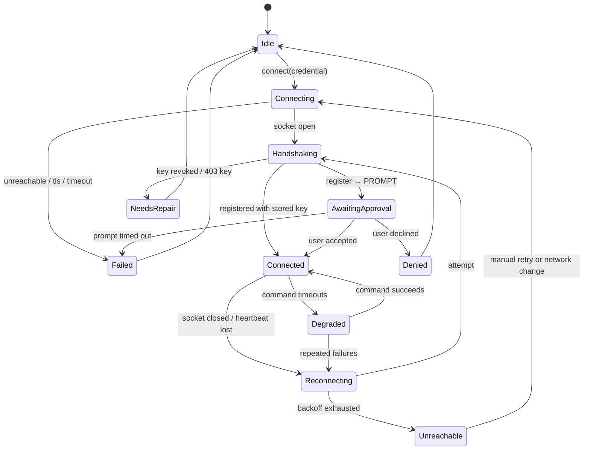

# Architecture proposal — Smart Remote (LG webOS TV)

Version 0.1 · Milestone 0 · Status: **for review, no application code written**

---

## 1. Scope

### 1.1 MVP in scope

1. Discover an LG webOS TV on the local network (native platforms) or accept a manually entered IP.
2. Pair through the TV's on-screen approval prompt and obtain a `client-key`.
3. Store that key securely on the device and reconnect silently afterwards.
4. Send: volume up/down, mute toggle, power off, D-pad navigation, OK, back, home.
5. Show truthful connection status, capability-aware controls and actionable errors.
6. Test all of the above against a mock TV, then validate on real hardware using a checklist.

### 1.2 Explicitly out of scope for MVP

* Powering the TV **on** (requires Wake-on-LAN and a known MAC; see §7.4).
* App launcher, input switching, channel lists, keyboard input, text entry.
* Cloud relay, remote access from outside the LAN, scheduling or automations.
* Multi-TV simultaneous control (one active TV at a time; multiple TVs can be saved).
* Supabase accounts and sync (post-MVP, §9).

### 1.3 Non-negotiable constraints

| Constraint | How the architecture enforces it |
| --- | --- |
| Never expose TV control ports to the internet | No relay, no tunnelling, no port-forwarding guidance; optional bridge binds loopback/LAN only and rejects non-allowlisted origins |
| Never transmit pairing keys to a cloud backend | Keys exist only in platform keystore (or bridge keystore); Supabase schema and tests forbid secrets |
| Do not assume uniform webOS capability | Capability probe at connect; per-TV feature flags; disabled controls carry a reason |
| Do not claim a command works unless tested | Mock tests are labelled as conformance only; hardware claims require signed QA checklist rows |
| Protocol independent of UI | `packages/webos_ssap` has no Flutter imports; enforced by an import-boundary check in CI |
| Never overwrite production code or merge without approval | Protected `main`, feature branches, review gates, no auto-merge |

---

## 2. Context and constraints discovered during research

Details and sources: [protocol-notes.md](protocol-notes.md).

1. **Two transports.** `ws://<ip>:3000` (older sets) and `wss://<ip>:3001` (2022+ firmware often *only* this). The 3001 certificate is self-signed, so certificate verification must be relaxed on native — and browsers cannot relax it at all.
2. **Pairing is per transport.** A key granted over `wss` is not honoured over `ws`. The stored credential must therefore include the transport and port, not just the key.
3. **Pairing is prompted.** The first `register` shows a dialog on the TV with roughly a 60-second window; denial and timeout are normal outcomes that must be handled as first-class states.
4. **Capabilities vary.** ARC/eARC soundbars can report `volume: -1`, making absolute `setVolume` useless; mute may not affect an external soundbar; pointer-socket button names differ by generation.
5. **Discovery is multicast.** SSDP to `239.255.255.250:1900` with `ST: urn:lge-com:service:webos-second-screen:1`. It fails across VLANs and with AP client isolation, and each mobile platform gates it differently (Android multicast lock; iOS multicast entitlement or Bonjour).
6. **Browsers are structurally limited.** No UDP/multicast, no `ws://` from an `https://` page, no way to trust the TV's self-signed `wss` certificate, and no secure place for a long-lived key. The web client cannot be feature-equivalent, and the architecture must say so rather than pretend.

---

## 3. System overview

```
┌──────────────────────────────────────────────────────────────┐
│ apps/remote — Flutter (iOS · Android · web)                   │
│  widgets · theme · responsive layout · accessibility          │
└───────────────▲──────────────────────────────────────────────┘
                │ typed state + commands (no protocol types)
┌───────────────┴──────────────────────────────────────────────┐
│ packages/remote_core — orchestration                          │
│  RemoteController · DeviceStore · CapabilityModel             │
│  ConnectionPresenter · ErrorMapper · CommandQueue             │
└───────▲──────────────────────────────▲───────────────────────┘
        │ SsapClient API               │ DiscoveryService
┌───────┴────────────────┐   ┌─────────┴───────────────────────┐
│ packages/webos_ssap    │   │ plugins/lg_discovery            │
│  codec · session       │   │  Android SSDP + multicast lock  │
│  pairing · commands    │   │  iOS Bonjour / multicast        │
│  pointer channel       │   │  manual IP (all platforms)      │
│  transport (ws/wss)    │   └─────────────────────────────────┘
└───────▲────────────────┘
        │ WebSocket (LAN only)
┌───────┴────────────────┐   ┌─────────────────────────────────┐
│ LG webOS TV (SSAP)     │   │ CredentialStore (platform)      │
│  :3000 ws / :3001 wss  │   │  Keychain · Keystore · memory   │
└────────────────────────┘   └─────────────────────────────────┘
```

Dependency rule: presentation → core → protocol → transport. The protocol package knows nothing about Flutter, storage or UI; storage is injected as an interface so it can be faked in tests.

---

## 4. Module design

### 4.1 `packages/webos_ssap` (pure Dart)

| Component | Responsibility |
| --- | --- |
| `SsapTransport` | Interface: `connect()`, `send(String)`, `Stream<String> messages`, `close()`. Implementations: `IoTransport` (native, `ws`/`wss`, injectable certificate policy) and a web transport that refuses `wss` with an untrusted certificate and refuses `ws` in a secure context. |
| `FrameCodec` | Decode/encode the JSON envelope; reject malformed frames without killing the session. |
| `SsapSession` | One connection: `register` handshake, request id allocation, pending-response map with per-request timeouts, subscription registry, structured event stream, graceful close. |
| `PairingService` | Drives `register` → prompt → `registered`, returns a `TvCredential { host, port, secure, clientKey, modelName?, firmware? }`. Handles denial (403), timeout, revoked key. |
| `SsapClient` | Typed commands: `audio.volumeUp/volumeDown/setVolume/setMute`, `system.turnOff`, `channel.*`, `media.*`, `app.launch`, `probe.capabilities`. Every call returns `Result<T, SsapError>`; nothing throws into the UI layer. |
| `PointerInputChannel` | Second WebSocket from `getPointerInputSocket`; `button(name)`, `move(dx,dy)`, `scroll(dx,dy)`, `click()`. Coalesces high-frequency moves; reopened after reconnect. |
| `ConnectionSupervisor` | The state machine in §5. Owns backoff, single in-flight attempt, lifecycle pausing, subscription restoration. |
| `SsapLogger` | Redacts `client-key`, IPs and payload bodies; one switch to disable entirely. |

Deliberate choices:

* **No global singleton.** A `TvConnection` is created per TV and disposed with it, so tests and multi-TV support do not share hidden state.
* **No hidden retries inside a request.** Retry policy lives in the supervisor, so the UI's status matches reality.
* **Clock and transport injected.** Timeout behaviour is testable in milliseconds, not minutes.

### 4.2 `packages/remote_core`

`RemoteController` exposes an immutable `RemoteState`:

```
RemoteState {
  phase: noDevice | connecting | awaitingApproval | connected | degraded | error
  device: SavedTv?
  volume: int?          muted: bool?
  capabilities: CapabilitySet
  lastError: RemoteError?
}
```

* `CapabilitySet` has explicit flags (`hasAbsoluteVolume`, `hasMute`, `hasPointer`, `hasChannel`, `hasMediaTransport`) each with `unknown | supported | unsupported`. Unknown means "not probed yet", and the UI shows the control as available but unconfirmed.
* `CommandQueue` coalesces volume repeat presses into steps, caps burst length and drops stale presses after disconnect, so the TV is never flooded with a backlog after a dropout.
* `ErrorMapper` turns `SsapError` into user-facing copy plus a recovery action (retry, re-pair, check network, enable LG Connect Apps).

### 4.3 `apps/remote` (Flutter)

* One screen: device list → remote. Tablet and landscape use a two-pane layout.
* Dark, high-contrast theme designed around thumb reach: volume and D-pad within the lower third on phones.
* Every button has a semantic label, 48 dp minimum target, and a visible disabled reason surfaced as a tooltip/subtitle, not a toast that disappears.
* Connection banner is driven only by `RemoteState.phase`; it never optimistically shows "connected".
* Power off asks for confirmation, since it is disruptive and not always recoverable without the physical remote (power-on is post-MVP).

### 4.4 `plugins/lg_discovery`

Federated plugin with a common Dart API: `Stream<DiscoveredTv> discover({Duration timeout})`.

* **Android:** SSDP `M-SEARCH`, multicast lock held only during the sweep, `WifiManager` to detect network changes; fall back to a bounded subnet scan when multicast is blocked.
* **iOS:** Bonjour browse for `_lg-mrt._tcp`; raw SSDP only when the multicast entitlement is present. `NSLocalNetworkUsageDescription` triggers the system permission prompt — first launch must explain why.
* **Web:** unsupported by design; returns an empty stream and a typed `DiscoveryUnsupported` reason that the UI renders as guidance.
* **Manual entry** is always available and is the universal fallback.

---

## 5. Connection state machine



Rules:

* Exactly **one** attempt in flight; new triggers are ignored while connecting.
* Backoff 1 s → 2 s → 4 s → 8 s → 16 s → 30 s cap, ±20 % jitter, reset after 60 s of stability.
* Reconnect pauses when the app is backgrounded (mobile) and resumes on foreground with a single immediate attempt.
* On `Registered` after a reconnect, re-subscribe to the previous topics and re-open the pointer socket before reporting `connected`.
* Distinguish "TV is off/unreachable" from "wrong network" by checking whether the device is still discoverable and whether we are on the SSDP-capable network.

---

## 6. Pairing and credential handling

### 6.1 Flow (native)

1. User picks a TV (discovered or manual IP) → `Connecting`.
2. Open `wss://:3001`; on failure fall back to `ws://:3000` and remember the choice.
3. Send `register` with a minimal manifest and `pairingType: "PROMPT"` (no stored key).
4. TV shows the approval dialog → app shows `AwaitingApproval` with a 75 s client timeout (covers the TV's ~60 s window) and a cancel action.
5. `registered` → store `TvCredential` in platform keystore → `Connected`. Any later launch reuses the key with no prompt.
6. Denial → `Denied` with "You declined on the TV" and a retry. Timeout → retry guidance. `403` on a stored key → clear the key, `NeedsRepair`, and re-pair once automatically, explaining that the TV no longer recognises this phone.

### 6.2 Credential record

```
TvCredential {
  host, port, secure,          // transport is part of the identity
  clientKey,                   // secret — keystore only
  modelName, webosVersion,     // for capability defaults
  certFingerprint?,            // diagnostic, TOFU
  lastSeen
}
```

### 6.3 Storage per platform

| Platform | Mechanism | Details |
| --- | --- | --- |
| iOS | Keychain generic password | `AfterFirstUnlockThisDeviceOnly`, `synchronizable = false` so keys never leave the device via iCloud |
| Android | Keystore-backed AES-GCM (via secure storage plugin) | excluded from Auto Backup; `allowBackup=false` or explicit rules |
| Web | **None** | no key stored; browser session uses memory only (limited mode, §8) |
| Bridge | Host OS keystore / restricted file | keys never exposed to the browser |

### 6.4 Logging and diagnostics

Keys, IPs and full payloads are redacted by default. A debug-only log view can be enabled per session and never persists. CI runs a test asserting that a known key string cannot appear in any logger output.

---

## 7. Security model

### 7.1 Assets

Client keys (highest), TV IP/MAC (privacy), command history (low).

### 7.2 Threats and mitigations

| Threat | Mitigation |
| --- | --- |
| Malicious app on the LAN impersonating the TV to harvest a key | Prefer `wss`; show discovered model name and require the user to confirm the TV; record certificate fingerprint and warn on change (trust on first use) |
| Passive sniffing of commands on plain `ws` | Prefer `wss`; if the TV offers only `ws`, surface a "connection is not encrypted on this TV" notice rather than hiding it |
| Key exfiltration via backups or cloud sync | `ThisDeviceOnly` Keychain item, Android backup exclusion, no key in Supabase, redaction tests |
| XSS stealing a web-stored key | no key storage in the browser at all |
| Control port exposed to the internet | no relay; bridge binds loopback/LAN with origin allowlist and token auth; docs never suggest port forwarding |
| Malicious web page driving the local bridge (DNS rebinding/CSRF) | bridge rejects unknown `Origin`, requires a per-install bearer token, validates `Host`, no CORS wildcard |
| Over-broad TV permissions via manifest | request the smallest permission set that covers MVP commands; document each |
| Logs or crash reports leaking secrets | redaction layer, opt-in diagnostics, no payload logging in release |

### 7.3 Accepted residual risks

* The TV's self-signed certificate means TLS is effectively unauthenticated; a LAN attacker can MITM `wss`. Mitigated (not eliminated) by fingerprint pinning warnings.
* Anyone who can press "Accept" on the TV can pair. Physical presence is the security boundary, which matches LG's design.
* Rooted/jailbroken devices can read keystore contents.

### 7.4 Power on (post-MVP note)

Power-on needs Wake-on-LAN: magic packet to UDP 9 with the TV's MAC, plus "Mobile TV On"/network standby enabled on the set. Resolving the MAC via `ssap://com.webos.service.networkinterface/getNetworkStatus` is **unverified**. WoL will be a separate feature with its own QA rows, and it will not be advertised as part of MVP.

---

## 8. Web strategy — the honest limits

| Capability | Browser | Consequence |
| --- | --- | --- |
| SSDP/mDNS discovery | Impossible (no UDP) | Manual IP entry; explain why |
| `ws://` to the TV from an `https` page | Blocked (mixed content) | Hosted HTTPS web build cannot speak plain `ws` |
| `wss://:3001` with self-signed cert | Impossible to accept | Browsers cannot pair a secure-only TV directly |
| Long-lived key storage | No secure store | No key in `localStorage`/IndexedDB; session memory only |
| Background reconnect | Page must stay open | Status must reflect tab lifecycle |

**Therefore the direct browser path is limited to:** a web build served over plain `http://` on the same LAN, with a manually entered IP, using `ws://:3000`, and a pairing key kept in memory for the session only. That is a legitimate but narrow mode, and the UI must state it plainly.

**Documented alternatives (research track, M7):**

* **A. Local bridge (recommended if web parity matters).** A small companion service on the user's machine or a Pi that holds keys in OS keystore, speaks `wss` to the TV, and serves the web client **same-origin over loopback HTTP** (or over LAN behind TLS with a trusted certificate). Constraints: binds loopback/LAN only, origin allowlist, per-install bearer token, no UPnP, never reachable from the internet. The browser never sees a key.
* **B. Do nothing** and ship web as a manual-IP LAN client only, documented as unsupported on hosted HTTPS. Acceptable for MVP if explicitly labelled.
* **C. Native shell around the web build** — defeats the purpose; rejected.

Decision needed from the product owner (see §13). MVP ships the narrow mode plus a limitations screen; the bridge is a timeboxed spike, not a commitment.

---

## 9. Supabase boundary (optional, post-MVP)

Allowed: `profiles`, `device_nicknames(user_id, device_hash, nickname)`, `ui_preferences`. All with RLS scoped to `auth.uid()`.

Forbidden: client keys, IP addresses, MAC addresses, pairing transcripts, command history by default.

Enforcement: schema review, a migration test asserting column names/types cannot hold secrets, and a client-side DTO boundary where the sync model simply has no field for a key. Device identity for sync is a locally generated random UUID, not an IP or MAC.

---

## 10. Error taxonomy and UX mapping

| Category | Examples | User message | Recovery |
| --- | --- | --- | --- |
| Network | unreachable, timeout, wrong subnet | "Can't reach the TV. Check you're on the same Wi-Fi." | Retry, open manual IP |
| Transport | TLS rejected, mixed content, port closed | "This TV requires a secure connection the browser can't make." | Choose another mode / bridge |
| Auth | not paired, denied, prompt timeout, key revoked | "Approve the request on your TV." / "The TV no longer recognises this phone." | Re-pair |
| Protocol | 404 unknown URI, 401 permission, 500 app error | "This TV doesn't support that." | Disable control, log |
| Capability | ARC volume, mute unsupported | "Volume is controlled by your soundbar." | Use step volume |
| Lifecycle | app backgrounded, TV in standby | "TV is off or asleep." | Wake with physical remote |

Every error carries a stable code so QA can reference rows precisely.

---

## 11. Testing strategy

| Level | What | How |
| --- | --- | --- |
| Unit | codec, id allocation, pending map, timeouts, backoff, capability parsing | `dart test`, injected clock |
| Protocol integration | real sockets against `tools/mock_tv` | mock profiles: accept, deny, timeout, revoked key, `ws`-only, `wss`-only, ARC `volume:-1`, unsupported URI (404), permission error (401) |
| State machine | all transitions in §5, including reconnect storms and background/foreground | scripted transport failures |
| Widget | control → command mapping, disabled reasons, banner truthfulness | Flutter widget tests |
| Golden | phone portrait/landscape, tablet, web width | golden files, reviewed diffs |
| Security | key redaction, no key in sync DTOs, bridge origin/token rejection | dedicated tests |
| Hardware | discovery, pairing, commands, resilience, accessibility | [qa-physical-tv-checklist.md](qa-physical-tv-checklist.md) |

Rules: mock tests are labelled **conformance**; the README never says "works on LG TVs" without hardware evidence. No test is skipped or weakened to go green — a failing mock test is a protocol bug.

---

## 12. CI and repository conventions

* `main` protected; PR required; no force push; no auto-merge.
* CI on Linux: `dart analyze`, `dart test` (protocol + core), `flutter analyze`, `flutter test`, golden checks.
* Android build check on Linux; iOS build only on a macOS runner (not available in this workspace).
* Import-boundary check: `webos_ssap` and `remote_core` must not import `flutter/widgets` or `material`.
* Conventional commits, scoped per package.

---

## 13. Decisions and remaining questions

**Approved 2026-11-19:**

1. **Minimum webOS version:** 2016+ (webOS 3.0). Prefer `wss`, fall back to `ws`, and let the capability probe drive the UI.
2. **Web scope:** the narrow manual-IP LAN mode ships in MVP; the local bridge remains a timeboxed M7 spike, not a commitment.
3. **Power on:** out of MVP. Wake-on-LAN is a later feature with its own checklist rows.

**Still open:**

4. **GitHub.** No remote is configured in this workspace. Which repository should receive branches and PRs, and is pushing authorised?
5. **Design language.** Any existing brand, icon or typeface, or shall I choose a dark theme and a working name for review at M3?
6. **Supabase.** Is a project available for M8, or does sync stay deferred indefinitely?

---

## 14. Milestones and risks

Full plan: [milestones.md](milestones.md).

| Risk | Impact | Mitigation |
| --- | --- | --- |
| iOS multicast entitlement approval delays discovery | Ships without SSDP on iOS | Bonjour fallback + manual IP from day one |
| Secure-only firmware (`wss:3001`) breaks browser mode | Web limited | Documented mode split; bridge research |
| Self-signed certificate prevents certificate pinning | MITM risk on LAN | Prefer `wss`, fingerprint-change warning |
| ARC soundbars report `volume:-1` | Absolute volume useless | Step commands as primary control |
| Capability drift across webOS generations | Broken controls on some TVs | Probe, per-TV flags, hardware matrix |
| iOS builds impossible in this Linux workspace | Verification gap | macOS runner + physical device for QA |
| Keys leaking via logs/backups | Security incident | Keystore-only, `ThisDeviceOnly`, redaction tests, security review gate |
